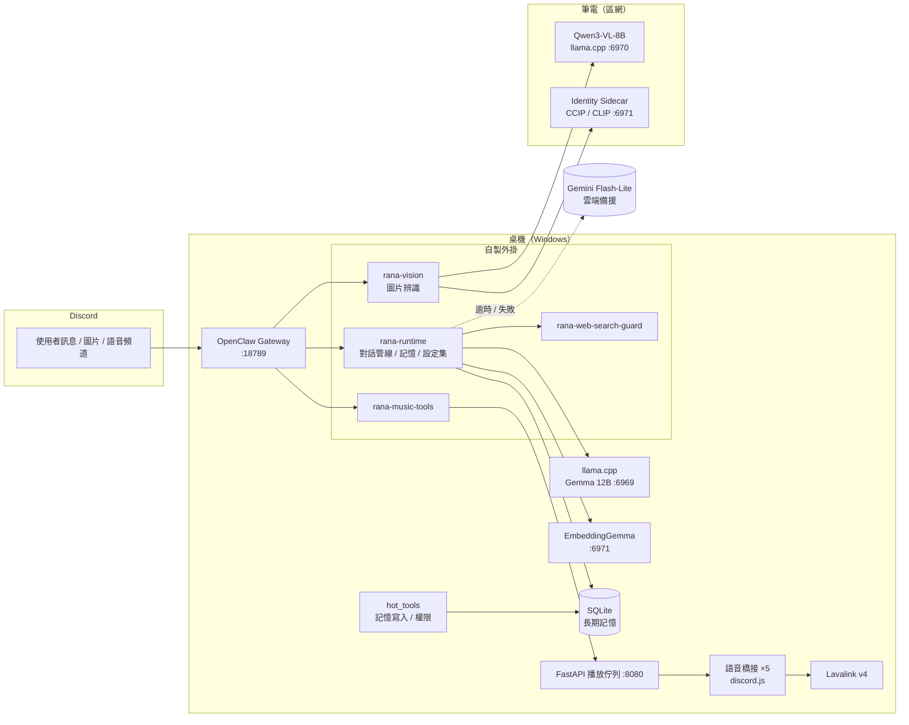
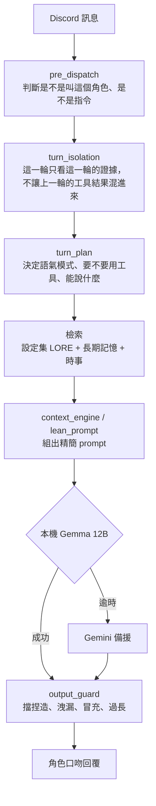
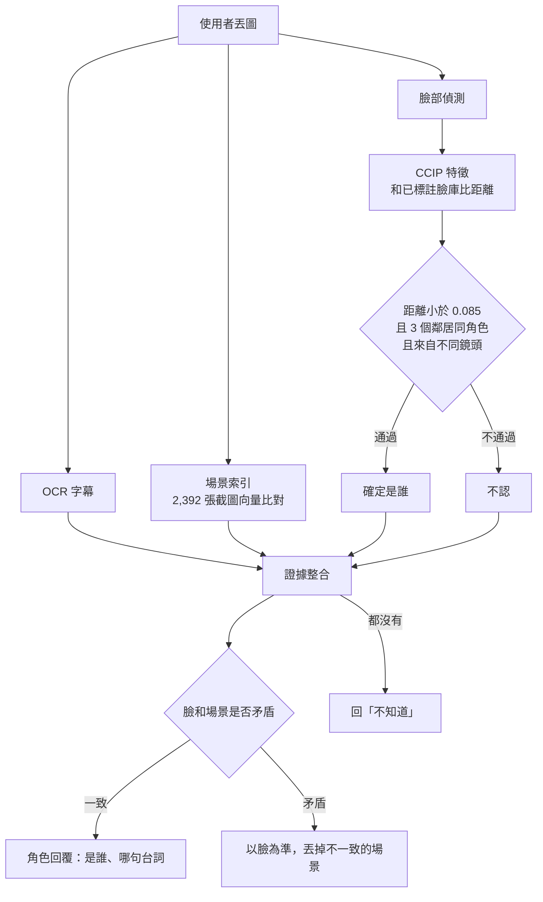

# Rana AI Agent

我在自己的 Discord 伺服器上養了五個 AI 角色：要樂奈、千早愛音、長崎爽世、椎名立希、高松燈（取自《BanG Dream! It's MyGO!!!!!》，非商業的同人作品）。她們會在群組裡聊天、記得大家教過的事、看得懂丟進來的動畫截圖，也會進語音頻道放歌。

這個 repo 是整套系統的原始碼。主模型跑在我自己的電腦上，雲端模型只在本機掛掉或太慢的時候接手。

*Five character bots for Discord, written as plugins for the OpenClaw gateway: local LLM first with a cloud fallback, long-term memory, anime face recognition, and voice music playback.*

## 這個專案在做什麼

一開始我只是想讓樂奈在群組裡陪大家聊天，後來越做越多。做下來發現，最難的不是讓模型會講話，而是讓它不要亂講。小模型很容易編出沒發生過的事、把別人教的東西講成自己的經歷、看圖的時候很有自信地叫錯名字。所以這個專案大部分的程式碼，其實都在處理「這句話有沒有根據」。

幾個我比較滿意的部分：

- 五個角色共用一套對話流程。每個角色有自己的 `PERSONA.json` 和設定集，但工具權限、記憶、輸出檢查是同一套，要加新角色不用重寫。
- 工具結果由程式決定，模型只負責講。歌有沒有放成功、記憶有沒有存進去、股價多少，都是程式先算好再交給模型，模型只能用角色的口吻轉述（`tool_receipt.js`）。回覆生成之後還會再檢查一次，擋掉捏造的事實和內部資訊。
- 本機優先。平常用我電腦上 llama.cpp 跑的 Gemma 12B，失敗或逾時才換 Gemini Flash-Lite。12B 能吃的 context 不多，我把原本每一輪都要塞進去的 187 行規則壓成精簡版的 prompt，它才跑得動。
- 長期記憶。有人說「記住 …」就會存進 SQLite。關於自己的事只有本人查得到，關於別人或群組梗的會共用，也會記下是誰教的。密碼、token、證件號碼這類東西不會被存。
- 看圖認角色。我一開始直接丟給視覺模型猜，40 張只對 5 張，而且錯的時候還很篤定。後來改成用 CCIP（動漫臉部特徵）去比對我標註過的臉庫，held-out 測試 top-1 是 97%，原本用 CLIP 只有 65%。再加上 OCR 和 2,392 張截圖做成的場景索引，找出是哪一幕、哪句台詞。距離不夠近或證據互相矛盾的時候，就回答不知道。
- 語音放歌。用 discord.js 做語音橋接、Lavalink v4 播放，播放佇列是用 FastAPI 寫的。

## 系統架構



## 一則訊息怎麼變成回覆



## 看圖的流程

臉部比對要同時符合三個條件才算認出來：距離夠近、最近的三個鄰居都是同一個角色、而且來自不同鏡頭。臉和場景對不上的時候，我選擇相信臉。



## 我怎麼驗證

- 大約 570 個 `node:test` 單元和回歸測試。每修一個 bug 我就補一個測試，例如「剛記住的事，馬上問『X 是誰』卻回答不知道」。
- Live 測試：固定 21 句對話，直接在 Discord 上跑，看每個角色實際怎麼回。
- 看圖用盲測。我先用肉眼把測試圖分成清楚、模糊、幾乎認不出來三級，再讓系統跑分，避免拿答案卷考自己。驗收標準是清楚的主角至少 95% 認對，而且一個名字都不能叫錯。

## 開發方式

這個專案我是和 AI coding agent（Claude、GPT）一起做的。需求、架構決策、驗收標準和測試由我決定，大部分實作和一部分 code review 交給 agent。我也用一套任務派發流程（TaskBus）把實作、測試、審查分給不同的 agent，各做各的再由我驗收。

## 技術棧

- **語言**：JavaScript / TypeScript（Node.js 22+）、Python、PowerShell
- **Agent 框架**：OpenClaw gateway + 自製外掛
- **模型**：Gemma 12B（llama.cpp，本機）、Gemini 3.1 Flash-Lite（備援）、Qwen3-VL-8B（看圖）、EmbeddingGemma（向量）、CCIP / CLIP（角色辨識，onnxruntime / transformers.js）
- **資料**：`node:sqlite`、JSON 向量索引
- **服務**：FastAPI + uvicorn、discord.js 14、Lavalink 4、yt-dlp、Ollama（網路搜尋）
- **測試**：`node:test`、Python `unittest`

## 專案結構

```
extensions/
  rana-runtime/        對話管線、角色、記憶、設定集檢索、輸出檢查
    architecture/      turn plan、turn isolation、context engine、tool receipt
    memory/            SQLite 長期記憶
    lore/              設定集與記憶檢索
  rana-vision/         圖片辨識（臉、OCR、場景索引、證據整合）
  rana-music-tools/    音樂工具註冊
  rana-web-search-guard/  不認識的詞先查網路再回答
workspace/             主角色（樂奈）的人格、設定集、服務
  services/
    identity_sidecar/  筆電上的角色辨識服務
    music_core/        語音橋接、FastAPI 佇列
    rana_hot_tools/    記憶寫入與權限
workspace-bots/        另外四個角色（愛音、爽世、立希、燈）
scripts/               設定集索引、測試 runner、工具腳本
```

## 執行

這是我本機實際在跑的原始碼，需要 OpenClaw gateway、llama.cpp、Lavalink 等外部程式（見 [EXTERNAL_BINARIES.md](EXTERNAL_BINARIES.md)），Discord ID 和區網主機位址放在不進 git 的 `discord_ids.local.json`、`hosts.local.json`（範例：`discord_ids.example.json`、`hosts.example.json`）。

只跑測試：

```bash
cd extensions/rana-runtime && node --test
cd extensions/rana-vision && node --test
```
