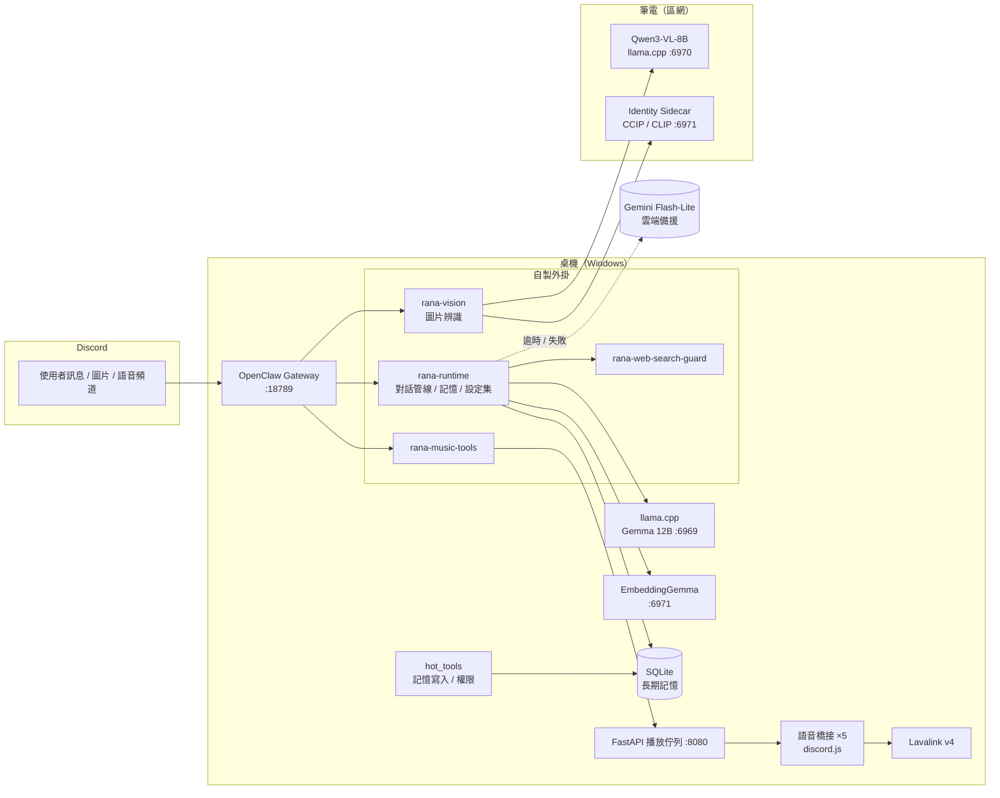
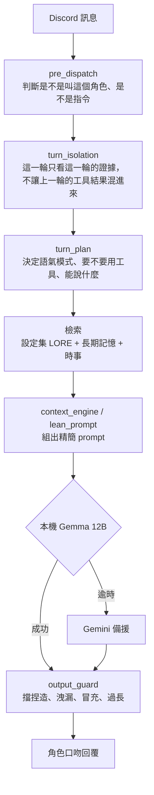
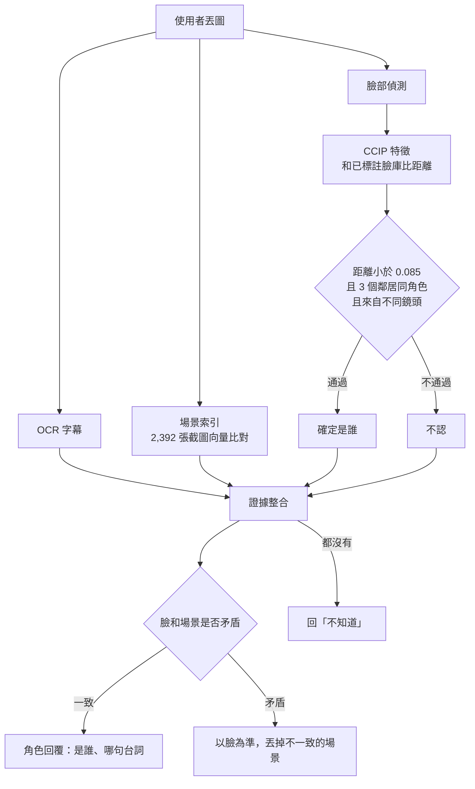

# Rana AI Agent

> 一個跑在 Discord 上的多角色 AI 夥伴系統：五個角色各自有人格、記憶、看圖、放音樂的能力，主模型跑在自己的電腦上（llama.cpp），雲端模型只當備援。
>
> A self-hosted, multi-persona Discord agent built on the OpenClaw gateway: local-first LLM routing, per-user long-term memory, anime-face identity recognition, and a voice music bot — with ~570 automated tests guarding persona and tool contracts.

這是一個非商業的同人作品，角色取自《BanG Dream! It's MyGO!!!!!》（要樂奈、千早愛音、長崎爽世、椎名立希、高松燈）。

---

## 重點

- **五個角色、一套 runtime**：同一個 gateway 底下跑五個 Discord bot，每個角色有自己的 `PERSONA.json`、設定集（LORE）和語氣規則，但共用同一套對話管線、工具權限和輸出檢查。
- **本地優先的模型路由**：主模型是本機 llama.cpp 上的 Gemma 12B，失敗或逾時才切到 Gemini Flash-Lite。看圖用另一台筆電上的 Qwen3-VL-8B，向量檢索用本機 EmbeddingGemma。
- **「不准亂講」的架構**：工具結果（放歌、記憶、股價、圖片辨識）由程式決定真假，模型只負責用角色的口吻講出來（`tool_receipt.js`）。模型生成之後還有一層 output guard 擋掉捏造事實、洩漏內部資訊、冒充別的角色。
- **長期記憶**：「記住 …」寫進 SQLite，分成個人記憶和群組共用記憶，有權限控管和敏感資訊過濾（密碼、token、身分證號不會被記下來）。問問題時記憶和設定集一起做向量檢索。
- **看得懂動畫截圖的視覺管線**：臉部偵測 + CCIP 動漫臉特徵比對認角色（held-out top-1 97%，原本 CLIP kNN 只有 65%），再加 OCR 和 2,392 張截圖的場景索引找出「這是哪一集哪句台詞」。認不出來就說不知道，不亂猜。
- **語音音樂機器人**：discord.js + Lavalink v4，FastAPI 做播放佇列，五個角色各自有語音橋接。
- **測試把關**：約 570 個 `node:test` 測試，涵蓋角色邊界、工具授權、對話隔離、記憶誠實度、視覺辨識門檻，每次修 bug 都補回歸測試。

## 系統架構



## 一句話進來之後發生什麼事



## 圖片辨識流程



## 我做了哪些事

| 領域 | 內容 |
|---|---|
| 對話 runtime | 設計 TurnPlan / turn isolation / context engine，把每一輪的證據來源分清楚；把 187 行 KEY=VALUE 規則壓成精簡 prompt（`lean_prompt.js`），本機 12B 模型才跑得動。 |
| 角色系統 | 五個角色的 `PERSONA.json` schema、語氣模式（例如「熱飲」模式）、角色邊界測試，確保愛音不會講成樂奈。 |
| 記憶 | SQLite 長期記憶、個人 / 共用範圍、作者追蹤、敏感資訊過濾、和設定集一起做向量檢索。修過「剛記住的東西問『X 是誰』卻答不知道」這類檢索 bug。 |
| 視覺 | 從「VLM 自己猜（40 張對 5 張）」改成「臉部特徵比對 + 場景索引 + 開放集門檻」；建立盲測流程（先人工分級再跑分），驗收標準是清楚的主角 ≥95%、錯名 0。 |
| 音樂 | Lavalink v4 + discord.js 語音橋接、FastAPI 佇列、播放策略。 |
| 維運 | 一支 PowerShell 管理 10 個服務的啟動、健康檢查與 watchdog；公開前的發布流程會掃描並拒絕 Discord ID、token、內部檔案。 |
| 測試 | `node:test` 單元 + 回歸測試約 570 個，加上 live 測試腳本（固定 21 句對話跑真 Discord）。 |

## 技術棧

- **語言**：JavaScript / TypeScript（Node.js 22+）、Python、PowerShell
- **Agent 框架**：OpenClaw gateway + 自製外掛
- **模型**：Gemma 12B（llama.cpp，本機）、Gemini 3.1 Flash-Lite（備援）、Qwen3-VL-8B（看圖）、EmbeddingGemma（向量）、CCIP / CLIP（角色辨識，onnxruntime / transformers.js）
- **資料**：`node:sqlite`、JSON 向量索引
- **服務**：FastAPI + uvicorn、discord.js 14、Lavalink 4、yt-dlp、Ollama（網路搜尋）
- **測試**：`node:test`、Python `unittest`

## 專案結構

```
extensions/
  rana-runtime/        對話管線、角色、記憶、設定集檢索、輸出檢查
    architecture/      turn plan、turn isolation、context engine、tool receipt
    memory/            SQLite 長期記憶
    lore/              設定集與記憶檢索
  rana-vision/         圖片辨識（臉、OCR、場景索引、證據整合）
  rana-music-tools/    音樂工具註冊
  rana-web-search-guard/  不認識的詞先查網路再回答
workspace/             主角色（樂奈）的人格、設定集、服務
  services/
    identity_sidecar/  筆電上的角色辨識服務
    music_core/        語音橋接、FastAPI 佇列
    rana_hot_tools/    記憶寫入與權限
workspace-bots/        另外四個角色（愛音、爽世、立希、燈）
scripts/               設定集索引、測試 runner、工具腳本
```

## 執行

這個 repo 是作者本機部署的原始碼，需要 OpenClaw gateway、llama.cpp、Lavalink 等外部程式（見 [EXTERNAL_BINARIES.md](EXTERNAL_BINARIES.md)），Discord ID 和區網主機位址放在不進 git 的 `discord_ids.local.json`、`hosts.local.json`（範例：`discord_ids.example.json`、`hosts.example.json`）。

只跑測試：

```bash
cd extensions/rana-runtime && node --test
cd extensions/rana-vision && node --test
```
